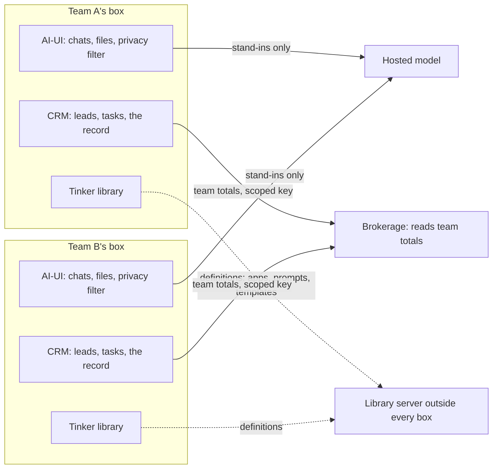

# Federation

Teams can share their work without sharing their records. Each team keeps its own box, and three rules say what may leave it.

## Three rules

1. **Data stays home.** Records about people stay in the box that holds them: leads, clients, chats, files, deal files. Models see them only through that box's privacy filter, as stand-ins.
2. **Definitions travel.** Apps, agents, prompts, task templates, targets, connector manifests and Sprigs may move between boxes. A definition carries no data, and a scan proves it before it leaves.
3. **Numbers travel with consent.** A team may give an umbrella, such as a brokerage, a key that reads team totals. That key reads nothing else, and the team revokes it by deleting it.

A box is one team's or one client's install: its AI-UI, its CRM and its Tinker library, on hardware it controls.

Tinker.Click builds a small app from one sentence and keeps it in that library.

## The map

Dotted lines carry definitions. Solid lines carry team totals and stand-ins. No line carries a record about a person.

## Data, definitions and numbers in AI-UI

### Data stays in the box

- Chats, at `/api/v1/chats`.
- Files, at `/api/v1/files`, kept on local disk under `UPLOAD_DIR`.
- Knowledge content, at `/api/v1/knowledge`, and its vectors.
- Memories, at `/api/v1/memories`, and notes, at `/api/v1/notes`.
- Space messages, at `/api/v1/spaces/{id}/messages`.
- Feedback ratings. A rating can keep a `snapshot` of the rated chat.
- The privacy map. The `privacy_map` table pairs each stand-in with its real value, so it never leaves the box.

### Definitions may travel

- Agents and model presets: rows in the `model` table, at `/api/v1/models`. The Workshop's Export Agents button saves them as JSON.
- Prompts, at `/api/v1/prompts`. The Workshop's Export Prompts button saves them.
- Tool definitions: the OpenAPI tool servers in `TOOL_SERVER_CONNECTIONS`. The address and its OpenAPI spec travel. The key stays home, and each box sets its own.
- Function definitions: Python code in the `function` table. Admins export them at `/api/v1/functions/export`.
- Sprigs. Each catalogue entry pins its artifact by sha256 digest (`binary_sha256` in `app/backend/sage_is_ai/sprigs/supervisor.py`), so a Sprig is the same bytes in every box.
- Themes. A theme Sprig carries design tokens only, in one `theme.css` that `app/backend/sage_is_ai/sprigs/theme_dispatch.py` checks at graft time.
- Later, Tinker.Click apps. See the Workshop section below.

A definition can still hide data. An Agent's system prompt, a prompt's text or a function's code may quote a client. AI-UI has no scan for this yet, so read every export before it leaves the box.

### Numbers travel with consent

- Numbers are counts and totals, such as chats a week or runs per Agent. They carry no names and no per-person rows.
- AI-UI has no endpoint that serves totals alone. `/api/usage` returns the IDs of active users and of the models in use, so its answer counts as data.
- An `sk-` key acts as the user who made it and reads what that user can read. So AI-UI cannot yet issue a key that reads totals alone.
- In the map, team totals reach the brokerage from each team's CRM, through a key scoped there.
- A user deletes an `sk-` key in Settings, Account, API keys, or with `DELETE /api/v1/auths/api_key`.

## The privacy filter is the box's edge

Every completion on `/api/chat/completions` passes through `generate_chat_completion` in `app/backend/sage_is_ai/utils/chat.py`. Spaces agent replies and background tasks call the same function. The privacy filter hangs there.

- Before text leaves for a hosted model, the filter swaps emails, phone numbers and Canadian postal codes for same-shape stand-ins. It puts the real values back into the reply. Card numbers are redacted one way. US ZIP codes and IP addresses are off by default.
- The filter covers OpenAI-compatible connections that are not marked local. It has been on by default since 3.2.0. Ollama and Function pipe models skip it, wherever the Ollama host runs. An admin sets it per connection or per model at `/pages/admin/privacy`.
- The filter does not find names. Add client names and other words as literal rules on the same page.
- Embedding, image and speech calls do not pass through it.

The raw proxy routes skip the filter too: `/openai/chat/completions`, the `/openai/{path}` catch-all, `/ollama/api/chat`, `/ollama/api/generate` and `/ollama/v1/chat/completions` ([product-stack.md](product-stack.md)). A model reached through them sees real values.

So limit any `sk-` key you give an outside client:

- Set `ENABLE_API_KEY_ENDPOINT_RESTRICTIONS=True`.
- List the paths it may call in `API_KEY_ALLOWED_ENDPOINTS`, comma-separated, for example `/api/models,/api/chat/completions`. A listed path also allows the paths under it.
- The list holds for every `sk-` key on the instance, not for one key. Give each outside client its own user as well.

## A team's CRM is a tool server in the same box

A team's CRM runs in the same box as its AI-UI. It registers as an OpenAPI tool server in `TOOL_SERVER_CONNECTIONS`, with a static bearer key. An agent named crm lets users reach it as @crm.

- The key reads that box's CRM and nothing else.
- Each box has its own CRM and its own key.
- AI-UI ships no CRM wiring. Each box sets it up by hand ([product-stack.md](product-stack.md), Edges).

## Maps

A street address is a record about a person. A map service learns each place it draws, geocodes or routes.

- Area maps draw public outlines inside the box, so no map company learns which places a team looks at.
- Street maps of real addresses wait for a map Sprig that serves tiles, geocoding and routing inside the box. The Sprig catalogue has none yet.

## Tinker.Click apps in the Workshop: planned, not built

Tinker.Click apps will arrive in the Workshop later. Each app calls three things: storage, ask and connector. The Workshop will give each one a bridge, so an app's data stays home.

- **A tab.** `/workshop/apps` sits beside Agents, Knowledge and Prompts, behind a new `workshop.apps` key in `USER_PERMISSIONS["workshop"]`.
- **A sandboxed frame.** Apps run in a frame like the chat Artifacts panel (`app/src/lib/components/chat/Artifacts.svelte`): `srcdoc`, `allow-scripts`, and no `allow-same-origin`. Such a frame's messages arrive with origin `"null"`, so the host checks `event.source` against the frame's window instead of `event.origin`.
- **Storage.** Each user's app state lives on the box. A frame without its own origin has no browser storage.
- **Ask.** Model calls go through `/api/chat/completions`, so the privacy filter covers them. They never use the raw `/openai` or `/ollama` routes.
- **Connector.** Connectors become AI-UI tool servers, as a team's CRM already is.

Until then, apps live in Tinker's library.

### A Tinker mini, in three steps

Tinker has no web build: its host page and agent loop need Tauri and Rust. A browser host can still run its apps, because they are plain HTML that talk to the host through `window.tinker`. Tinker's iOS host already does this and marks the native calls unavailable.

1. **Make, with no code.** A "Tinker mini" model preset in Workshop → Models. Its system prompt is adapted from Tinker's `core/prompts/system-compact.md`, with credit, and asks for one self-contained `html` code block. The Artifacts panel already runs that block in its sandboxed frame. Such an app has no saved state, model calls or network, which suits toys, quizzes, calculators and forms.
2. **Run, then make.** The apps tab above runs saved Tinker apps: the HTML files with the `<!-- tenkts-app {…} -->` header that Tinker's `/save-app` writes. Only storage, ask and connector cross the bridge; `fetch`, files, `run` and `browse` answer "not available here". A prompt box uses the step-1 preset and saves its result into the tab.
3. **One bridge contract.** A short written contract shared by Tinker desktop, iOS and AI-UI, offered upstream as a pull request.

Open questions:

- Does an embedded app wear Tinker's look or the host's?
- Tinker's `LICENSE` says AGPL-3.0, while its README and `Cargo.toml` files say MIT. The maintainer settles that.
- Apps that need `fetch` or `browse`, such as a web-clipping app, stay in Tinker desktop.

## Sharing outside the box

The community hub is planned as a sharing site outside every box ([community-hub.md](community-hub.md)). It is not built. Keep `ENABLE_COMMUNITY_SHARING` off. Its default is `False`. Under these rules, only definitions go there, and only after a scan.
